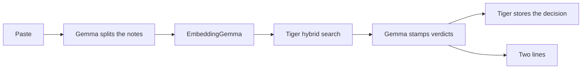

# Lazyyyyy

You paste the messages, notes, and links you are not going to read. Lazyyyyy stamps each one.

**Pardoned.** Nothing breaks if you ignore it.
**Two minutes.** Someone or a deadline is actually waiting, so it writes the reply.
**Already seen.** Tiger remembers you already got away with this, or the same ask showed up twice in the pile.

The only thing you are supposed to read is two lines.

## Why this is local

The notes people avoid are the personal ones: a lease, a person waiting, a chat they do not want in someone else's log. Gemma 4 E4B runs through Ollama on the same machine as the paste. EmbeddingGemma turns each note into a vector here too. Nothing in the pile is sent to a model API.

Tiger is the memory, not a log bolted on at the end. Every stamp is stored with its text and its embedding. The next similar note is found with hybrid search: BM25 keyword rank and pgvector cosine distance, fused with reciprocal rank fusion. Exact words such as "Friday" and "Priya" survive the keyword side. "Send the playlist whenever" still matches "the playlist when you can" on the vector side. Gemma stamps with those earlier decisions in front of it, so the pile gets lazier instead of re-litigating the same note.

A regular table is the right shape. Each row is a decision, not a measurement, so it is not a hypertable. The table lives in the `lazyyyyy` schema and leaves every other table on the service alone.



## Run it

You need Ollama, Python 3.11 or newer, and a Tiger Cloud service with the `vector` extension. `pg_textsearch` is used when the service has it. PostgreSQL full-text search is the fallback, and it is still hybrid keyword plus vector search.

Gemma 4 E4B needs about 6 GB of free memory to load. On a 16 GB machine, close extra browser windows first.

```bash
ollama pull gemma4:e4b
ollama pull embeddinggemma
python -m venv .venv
```

Windows:

```powershell
.\.venv\Scripts\python -m pip install -r requirements.txt
copy .env.example .env
```

macOS and Linux:

```bash
.venv/bin/pip install -r requirements.txt
cp .env.example .env
```

Put a Tiger connection string in `DATABASE_URL`. With the Tiger CLI:

```bash
tiger db uri YOUR_SERVICE_ID --with-password
```

Then start the app and open http://127.0.0.1:8765

```bash
.venv\Scripts\python -m uvicorn app.main:app --host 127.0.0.1 --port 8765
```

**Use the sample pile** plants two old pardons, a playlist and a newsletter, then judges six notes. The lease and Priya should take two minutes. The raccoon should be pardoned. The playlist, the newsletter, and the second lease note should come back as already seen.

```bash
.venv\Scripts\python -m pytest
```

## Deploy

Vercel runs the site. It does not run Gemma. A function has no room for the 6 GB E4B weights, and EmbeddingGemma is not a model on `ollama.com`. The two calls are split on purpose.

**Gemma chat, from Vercel.** Set `OLLAMA_HOST=https://ollama.com`, `GEMMA_MODEL=gemma4`, and `OLLAMA_API_KEY` from [Ollama API keys](https://ollama.com/settings/keys). The same `/api/chat` request the app already sends works there once the bearer token is set. Hobby functions stop at 300 seconds, so `OLLAMA_TIMEOUT=120` keeps the two Gemma calls inside that limit. The full list to paste is `deploy/vercel.env.example`.

**Embeddings.** `OLLAMA_EMBED_HOST` has to be an Ollama server with `embeddinggemma` pulled. `docker compose up --build` starts that server next to the app and points the app at `http://ollama:11434`. Publish only port 8765. Do not publish Ollama's port.

**Gemma on your own machine.** Leave `OLLAMA_HOST` at `http://127.0.0.1:11434` and `GEMMA_MODEL=gemma4:e4b`. That process needs about 6 GB free. To run that model inside Compose instead of the cloud, set `OLLAMA_HOST=http://ollama:11434`, `GEMMA_MODEL=gemma4:e4b`, and `PULL_CHAT_MODEL=gemma4:e4b` before `docker compose up --build`.

`GET /api/health` reports which Gemma path is configured. It does not show the key or the database URL.

## What a stamp is allowed to do

A date, money, or a named person waiting on a reply is never a pardon. A merge has to point at a real earlier note. If Gemma omits a stamp, the pile stops and asks you to try again, rather than quietly pardoning a deadline.
